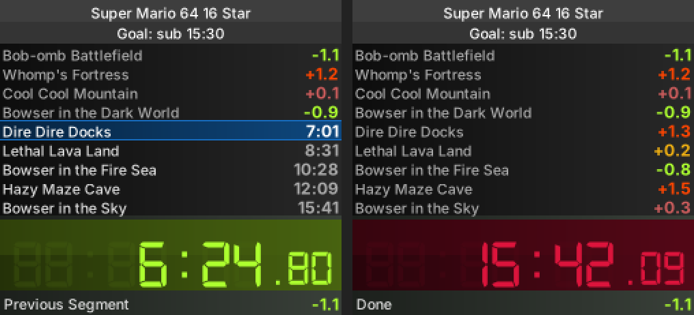
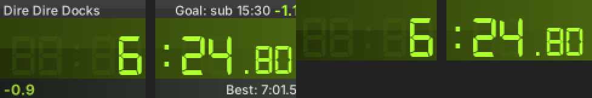

# WSplit — native macOS & Linux port

A native port of **WSplit 1.5.x**, the classic Windows speedrun split timer
by Wodanaz (SDA), later updated by Nitrofski and contributors.





This is **not** an emulation layer. It's a rewrite of the original C# logic
([github.com/Nitrofski/WSplit](https://github.com/Nitrofski/WSplit)) in portable
C, with a native front-end on each platform:

| | macOS | Linux |
|---|---|---|
| UI | Cocoa / AppKit (Objective-C) | X11 + cairo |
| Global hotkeys | Carbon `RegisterEventHotKey` (no Accessibility permission needed) | `XGrabKey` |
| Fonts | CoreText | cairo + FreeType |
| Run editor | Native table editor | Your text editor (auto-reload on save) |
| Settings | Settings window + right-click menu | Right-click menu |

## What carries over from the original

- **Your `.wsplit` files work as-is.** Same format (`Title=`, `Goal=`, `Attempts=`,
  `Offset=`, `Size=`, `Name,Old,Best,BestSegment`, `Icons=`), read and written with
  CRLF line endings, so files move freely between this port and Windows WSplit.
- All four display modes: **Timer only, Compact, Wide, Detailed**, with the same
  layout, gradients, colours and the Digital‑7 clock with "ghost" segments.
- Same split logic, ported line by line from `Split.cs`: comparisons (Old run,
  Personal best, Fastest, Sum of best segments), *Track best as* overall run or
  each split, best-segment detection (gold), delta colours, skip/unsplit, start
  delay, *Start at…*, attempt counter, "Set this run as old", double-tap prevention.
- Detailed-mode extras: previous segment, possible time save, sum of best,
  predicted time (PB / best).
- Segment icons (16/24/32 px), greyed out for past splits.
- Background styles (default/plain/black), always on top, opacity, decimal separator from your locale.
- Global hotkeys for split, pause, stop, reset, unsplit, skip, switch comparison,
  plus a toggle hotkey (shown as the green/red dot in the title bar).
- Window behaviour: borderless; drag anywhere to move; drag the clock edges to
  resize the clock; drag just above the clock (detailed) or the right-side
  separators (wide) to change how many segments are shown.
- LiveSplit `.lss` import (title, attempts, offset, PB splits, best segments).

### Keys (when WSplit has focus)

| Key | Action |
|---|---|
| Space / Return | Start / split |
| P | Pause / resume |
| R | Reset (offers to save new bests) |
| S | Stop |
| ← / → | Unsplit / skip split |
| ↑ / ↓ | Show more / fewer segments |
| 0 1 2 3 | Timer only / Compact / Wide / Detailed |
| Tab | Switch comparison |

Everything else is in the **right-click menu** (also the *Splits* menu in the macOS menu bar).

## Building

### macOS (10.13+; Apple Silicon and Intel)

```sh
xcode-select --install     # once, if you don't have the command line tools
make                       # builds WSplit.app (universal binary)
open WSplit.app
```

The app is ad-hoc signed. If macOS refuses to open it the first time,
right-click `WSplit.app` → **Open**. Drag it to `/Applications` to keep it.
Double-clicking `.wsplit` files opens them in WSplit.

> **Heads-up:** I could not compile the macOS version myself (no macOS SDK in
> my environment). The code was type-checked against stub headers with clang
> (`-Wall -Wextra`, ARC), but it has not run on a real Mac yet. If `make`
> reports an error, paste it back and it'll be a quick fix.

### Linux (X11; XWayland works too)

```sh
# Debian/Ubuntu
sudo apt install build-essential pkg-config libx11-dev libcairo2-dev libfreetype-dev
# Fedora:  sudo dnf install gcc make pkgconf libX11-devel cairo-devel freetype-devel
# Arch:    sudo pacman -S base-devel libx11 cairo freetype2

make
./wsplit examples/sm64_16star.wsplit
sudo make install          # optional: /usr/local/bin/wsplit + desktop entry
```

For a graphical file chooser install `zenity` (GNOME) or `kdialog` (KDE). Without
either, WSplit asks for the path in a text field.

**Editing runs on Linux:** *New/Edit Run* opens the splits file in your default text
editor (override with `WSPLIT_EDITOR=...`). Save it there and WSplit reloads it
automatically while the timer isn't running. Times may be written as seconds
(`83.45`) or `h:mm:ss.ff` (`1:23.45`); WSplit always saves seconds, so Windows
WSplit can still read the file. Avoid commas in segment names; the format doesn't
allow them (this is also true of the original).

**Wayland:** WSplit runs through XWayland. Global hotkeys from `XGrabKey` only fire
while an X11 window has focus, so they won't work over native Wayland games and
apps. On an X11 session they work everywhere.

## Where things are stored

| | macOS | Linux |
|---|---|---|
| Settings, colours, hotkeys, recent files | `~/Library/Application Support/WSplit/settings.ini` | `~/.config/wsplit/settings.ini` |

The settings file is plain `key=value` text. Colour schemes can be saved and loaded
as `.wscolors` files.

## Not ported (yet)

- The separate *Advanced detail window* (grid of columns + delta graph)
- Llanfair and SplitterZ import (LiveSplit import is included)
- Rainbow splits, background images, the "split times" column (these were hidden or
  unfinished in the last Windows build)
- The Windows "fallback timer" (not needed: the port uses the OS monotonic clock)
- Linux: a graphical run editor and colour picker (use the text editor / colour scheme files)

## Project layout

```
core/       portable C11: run model, timer, file formats, settings, menu model, renderer
linux/      X11 + cairo front-end (main.c, ui.c)
macos/      AppKit front-end (main.m, Dialogs.m, Info.plist)
assets/     Digital-7 Mono clock font, app icons
tests/      core unit tests (make test)
examples/   sample run
```

`make test` runs 66 unit tests that check the core against the C# semantics
(time formatting, split/best logic in both tracking modes, file round-trips, a file
written by Windows WSplit, settings).

## Credits & licences

- **WSplit**: Wodanaz (SDA); updated by Nitrofski and contributors. The C# source
  was published at github.com/Nitrofski/WSplit with an invitation to fork and modify;
  it has no formal licence file, so treat this port as a personal-use derivative.
- **Digital-7 Mono** clock font by Sizenko Alexander / Style-7, *freeware for
  personal use* (it is the same font embedded in the original WSplit.exe).
- The original's Nintendo-themed "missing icon" is intentionally not included; a
  neutral placeholder is drawn instead.
